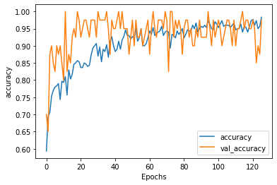
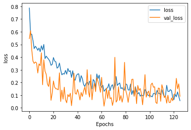
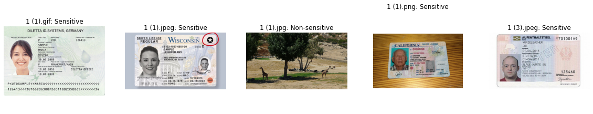
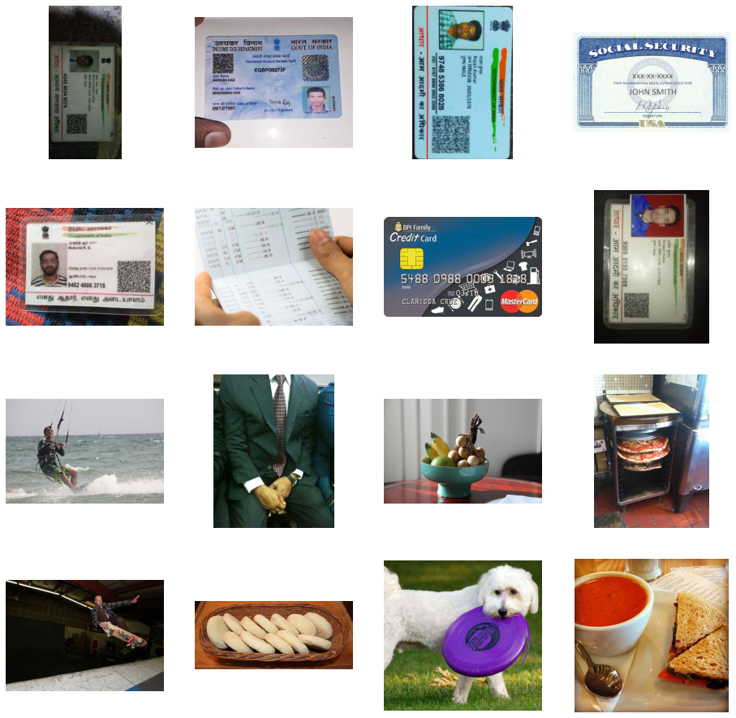

# Sensitive Data Classification

**Sensitive Data Classification using Deep Network with Sequential Models**

Paper: [ICRTC 2023, Springer](https://link.springer.com/chapter/10.1007/978-981-97-1724-8_34)

## Overview

This project trains a convolutional neural network (CNN) to decide whether an image contains sensitive information, such as an ID card, a credit card or a bank passbook, or is an ordinary photo. A model like this can flag images before they are shared, so personal details are not exposed by mistake.

## Repository layout

| Path | Content |
| --- | --- |
| `Sensitive_Data_Classification.ipynb` | Main notebook: data, model, training, plots and predictions on new images |
| `Sensitive-data.ipynb` | An earlier run of the same notebook |
| `dataset/` | Training and validation images, one folder per class |
| `training_set/` | 32 extra images used to test the trained model |
| `webapp/` | Browser app (TensorFlow.js) that runs the trained models, with Firebase Hosting config |
| `figures/` | Figures exported from the main notebook |

## Dataset

| Split | Sensitive | Non-sensitive | Total |
| --- | --- | --- | --- |
| Training | 300 | 300 | 600 |
| Validation | 50 | 50 | 100 |

**Sensitive** images cover Aadhaar cards (64), credit cards (59), driving licences (44), bank passbooks (30), ID cards (28), number plates (23), PAN cards (14), SSN cards (12), computer screens (10), documents (9), passports and visas (6) and one barcode. **Non-sensitive** images are everyday photos from the COCO 2014 training set.

## How to run

1. Open `Sensitive_Data_Classification.ipynb` in Google Colab with a GPU runtime
2. The first cell clones the image folders; to use the copy in this repository instead, point `training_folder` and `validation_folder` at `dataset/training` and `dataset/validation`
3. Run all cells; the last cell lets you upload your own images and labels each one

Libraries: TensorFlow / Keras, NumPy, Matplotlib, seaborn.

## Web app

`webapp/` is a browser app called **Sensitivity Checker**. You upload a picture and it runs two checks entirely in the browser:

| Check | How it works |
| --- | --- |
| Image | The trained CNN (converted to TensorFlow.js) scores the picture, resized to 150 × 150 |
| Text | Tesseract.js reads any text in the picture, and a text model scores the first 60 words |

The picture is marked **Sensitive** if either score is above 0.5. To run it locally, serve `webapp/public` with any static server (for example `python -m http.server`), after changing the icon and script paths in `index.html` from `C:\Users\...` to relative paths such as `assets/script.js`. It can be deployed with `firebase deploy` from the `webapp` folder.

## Notebook structure

| Section | Content |
| --- | --- |
| Sample data | 4 × 4 grid of training images from both classes |
| Model | 4 convolution + max-pooling blocks (32, 64, 128, 256 filters), a 512-unit dense layer and a sigmoid output; 6,811,969 parameters |
| Training | Images resized to 150 × 150 and scaled to [0, 1]; training images augmented with rotation, shifts, shear, zoom and flips; binary cross-entropy with Adam; up to 500 epochs, stopped early once training accuracy passes 98% |
| Plots | Training and validation accuracy and loss per epoch |
| Sample example | Upload any images and get a Sensitive / Non-sensitive label for each |

## Key results

| Measure | Result |
| --- | --- |
| Epochs run | 126 of 500 (stopped early at 98% training accuracy) |
| Training accuracy | 98.3% |
| Validation accuracy | 97.5% at the final epoch |
| Validation loss | 0.092 |

The paper also compares the CNN with SVM and logistic regression: the CNN reached 97.5% accuracy against 84.0% for SVM.

## Results in figures

**Validation accuracy stays above 90% for most of training** and finishes at 97.5%, close to training accuracy, so the model is not simply memorising the training images.

**The model labels new images it has never seen.** Four ID documents are marked Sensitive and the giraffe photo Non-sensitive.

**Sample training images** from both classes.

